<a href="https://www.linkedin.com/in/ghali-el-ouarzazi/">
  <picture>
    <source media="(max-width: 1100px)" srcset="./assets/banner-compact.svg">
    
  </picture>
</a>

 

### 01 / Selected work

  <a href="https://ghali.aliansact.com/en/projects/avail"><picture><source media="(prefers-color-scheme: light)" srcset="./assets/card-avail-light.svg"></picture></a>
  <a href="https://ghali.aliansact.com/en/projects/nexus"><picture><source media="(prefers-color-scheme: light)" srcset="./assets/card-nexus-light.svg"></picture></a>
   
  <a href="https://ghali.aliansact.com/en/projects/ternoa"><picture><source media="(prefers-color-scheme: light)" srcset="./assets/card-ternoa-light.svg"></picture></a>
  <a href="https://ghali.aliansact.com/"><picture><source media="(prefers-color-scheme: light)" srcset="./assets/card-more-light.svg"></picture></a>

### 02 / Stack

<picture><source media="(max-width: 1279px)" srcset="./assets/blank.svg"><source media="(prefers-color-scheme: light)" srcset="./assets/stack-light.svg"></picture><picture><source media="(min-width: 1280px)" srcset="./assets/blank.svg"><source media="(prefers-color-scheme: light)" srcset="./assets/stack-compact-light.svg"></picture>

### 03 / Get in touch

  <a href="https://ghali.aliansact.com/"><picture><source media="(prefers-color-scheme: light)" srcset="./assets/link-portfolio-light.svg"></picture></a>
  <a href="https://www.linkedin.com/in/ghali-el-ouarzazi/"><picture><source media="(prefers-color-scheme: light)" srcset="./assets/link-linkedin-light.svg"></picture></a>

